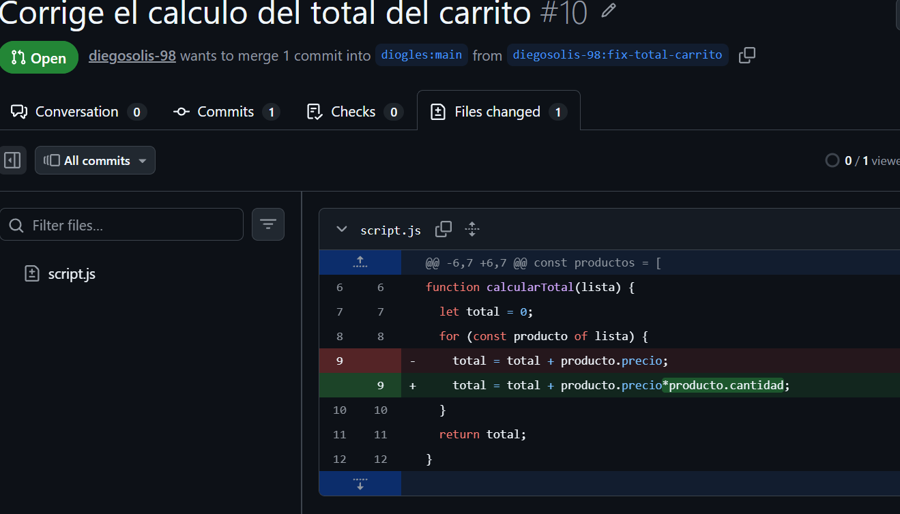

# Solucion del Laboratorio 3

Trabajos del curso Diseno de Interfaces de Programacion Avanzado.

## Sobre mi

Estudiante de Diseno y Desarrollo de Software en Tecsup.

## Contenido

### Trabajos del modulo 1

## Herramientas que uso

-	**Git** para el control de versiones
-	**GitHub** para el repositorio remoto
-	*Visual Studio Code* como editor

## Pasos para proponer una correción

1.	Hacer fork desde el repositorio de otra persona
2.	Ejecutar git clone para copiar en el repositorio local
3.	Entrar a la carpeta con cd
4.  Crear un issue en el repositorio del docente
5. Crear la rama de correción y hacer los cambios
6. Hacer el commit y subir la rama a nuestro fork
7. Crear el pull request

## Mi avance del modulo
-	[x] Laboratorio 01: Git basico
-	[ ] Laboratorio 03: Trabajo colaborativo


## Enlaces utiles

-	[Mi perfil de GitHub](https://github.com/diegosolis-98) 

## Captura de mi trabajo



## Comandos que mas uso

Para ver el estado del proyecto uso `git status`.

```bash
git clone https://github.com/diegosolis-98/tienda-tecsup.git 
git checkout -b fix-total-carrito
git add .
git commit -m "Actualiza el script.js"
git push origin main
```

| Comando | Que hace |
|--------------|----------------|
| `git clone` | Copia el proyecto al repositorio local |
| `git checkout` | Crea y a la misma vez nos mueve a la nueva rama |
| `git add` | Prepara los cambios |
| `git commit` | Guarda la version |
| `git push` | Sube los cambios al remoto |

> Documentar es parte del trabajo, no un extra al final.